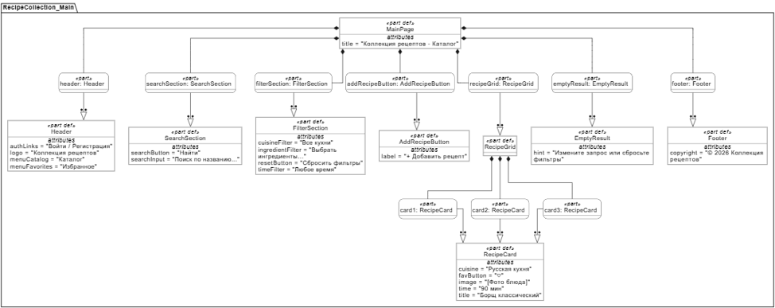
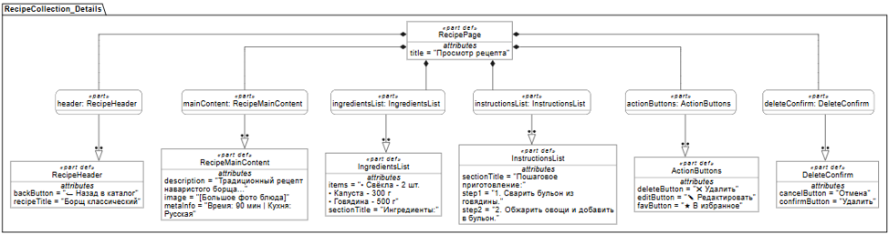
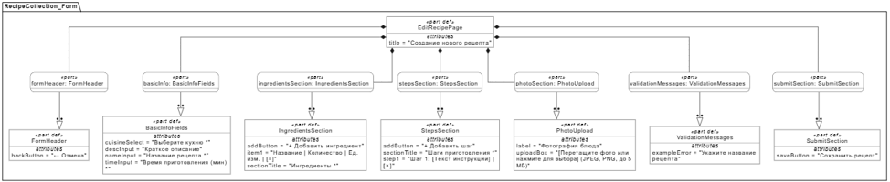
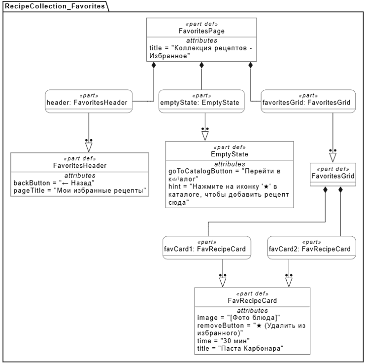
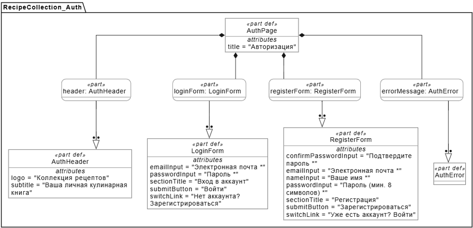

# Спецификация требований к ПО

Для "Коллекция рецептов"

Версия 0.1

Подготовила Лихимович А.В.

БГУИР, факультет КСиС, кафедра ЭВМ, гр. 450502

25.10.2026

## Оглавление

<!-- TOC -->
* [1. Введение](#1-introduction)
  * [1.1 Назначение документа](#11-document-purpose)
  * [1.2 Область применения продукта](#12-product-scope)
  * [1.3 Определения, акронимы и сокращения](#13-definitions-acronyms-and-abbreviations)
  * [1.4 Ссылки](#14-references)
  * [1.5 Обзор документа](#15-document-overview)
* [2. Обзор продукта](#2-product-overview)
  * [2.1 Перспектива продукта](#21-product-perspective)
  * [2.2 Функции продукта](#22-product-functions)
  * [2.3 Ограничения продукта](#23-product-constraints)
  * [2.4 Характеристики пользователей](#24-user-characteristics)
  * [2.5 Допущения и зависимости](#25-assumptions-and-dependencies)
  * [2.6 Распределение требований](#26-apportioning-of-requirements)
* [3. Требования](#3-requirements)
  * [3.1 Внешние интерфейсы](#31-external-interfaces)
    * [3.1.1 Пользовательские интерфейсы](#311-user-interfaces)
    * [3.1.2 Аппаратные интерфейсы](#312-hardware-interfaces)
    * [3.1.3 Программные интерфейсы](#313-software-interfaces)
  * [3.2 Функциональные требования](#32-functional)
  * [3.3 Качество обслуживания](#33-quality-of-service)
    * [3.3.1 Производительность](#331-performance)
    * [3.3.2 Безопасность](#332-security)
    * [3.3.3 Надёжность](#333-reliability)
    * [3.3.4 Доступность](#334-availability)
    * [3.3.5 Наблюдаемость](#335-observability)
  * [3.4 Соответствие стандартам](#34-compliance)
  * [3.5 Проектирование и реализация](#35-design-and-implementation)
    * [3.5.1 Установка](#351-installation)
    * [3.5.2 Сборка и поставка](#352-build-and-delivery)
    * [3.5.3 Распределение](#353-distribution)
    * [3.5.4 Сопровождаемость](#354-maintainability)
    * [3.5.5 Повторное использование](#355-reusability)
    * [3.5.6 Переносимость](#356-portability)
    * [3.5.7 Стоимость](#357-cost)
    * [3.5.8 Сроки](#358-deadline)
    * [3.5.9 Доказательство концепции](#359-proof-of-concept)
    * [3.5.10 Управление изменениями](#3510-change-management)
  * [3.6 ИИ/МО](#36-aiml)
    * [3.6.1 Спецификация модели](#361-model-specification)
    * [3.6.2 Управление данными](#362-data-management)
    * [3.6.3 Ограничители (Guardrails)](#363-guardrails)
    * [3.6.4 Этика](#364-ethics)
    * [3.6.5 Human-in-the-Loop](#365-human-in-the-loop)
    * [3.6.6 Жизненный цикл модели и операции](#366-model-lifecycle-and-operations)
* [4. Верификация](#4-verification)
* [5. Приложения](#5-appendixes)
<!-- TOC -->

## История изменений

| Name | Date | Reason For Changes | Version |
|------|------------|------------------------------------------|---------|
| Лихимович А.В. | 25.10.2026 | Первая версия по итогам сбора требований | 0.1 |
|      |            |                    |         |

---

## 1. Введение {#1-introduction}

### 1.1 Назначение документа {#11-document-purpose}

Настоящий документ определяет, **ЧТО** должно делать веб-приложение «Коллекция рецептов», но не то, КАК оно будет реализовано. Спецификация описывает назначение, границы, функциональные возможности и характеристики качества системы и служит основой для её проектирования, разработки и проверки.

Документ предназначен для следующих участников проекта:

- **Заказчик** — для определения ожидаемых возможностей приложения и проверки соответствия результата поставленным задачам.
- **Разработчик** — для понимания требований и реализации предусмотренной функциональности.
- **Тестировщик** — для подготовки проверок и оценки соответствия приложения установленным требованиям.
- **Преподаватель** — для оценки полноты и качества документирования требований в рамках лабораторной работы.

Спецификация может уточняться по мере разработки. Изменения фиксируются в истории изменений документа и в системе контроля версий Git.

### 1.2 Область применения продукта {#12-product-scope}

Веб-приложение «Коллекция рецептов» предназначено для хранения, просмотра и поиска кулинарных рецептов в едином электронном каталоге.

Зарегистрированные пользователи добавляют рецепты (название, описание, ингредиенты, шаги приготовления, время приготовления, кухню, фотографию), а все посетители могут просматривать каталог, искать блюда по названию и отбирать их по ингредиентам, времени приготовления и кухне. Авторизованный пользователь может сохранять понравившиеся рецепты в избранное.

Ожидаемый результат — сократить время выбора блюда и упростить систематизацию рецептов.

**Входит в область применения:**

- регистрация, вход и выход пользователя;
- создание, просмотр, редактирование и удаление рецептов;
- добавление фотографии к рецепту;
- поиск по названию и фильтрация по ингредиентам, времени приготовления и кухне;
- избранное.

**Не входит в область применения:** заказ продуктов, доставка еды, управление рестораном, мобильное приложение, рекомендательные алгоритмы, комментарии и социальные функции, подключение внешних сервисов.

Целевая аудитория — люди, которые хотят систематизировать рецепты и быстро находить подходящие блюда.

### 1.3 Определения, акронимы и сокращения {#13-definitions-acronyms-and-abbreviations}

| Term | Definition |
|------|------------|
| API | Application Programming Interface — набор определений и протоколов для создания и интеграции прикладного ПО |
| CRUD | Create, Read, Update, Delete — базовые операции с данными (создание, чтение, изменение, удаление) |
| SRS | Software Requirements Specification — документ, описывающий назначение, требования и характер ПО |
| UI | User Interface — визуальная часть приложения, через которую пользователь взаимодействует с ПО |
| Автор рецепта | Зарегистрированный пользователь, создавший рецепт; только он может изменять и удалять этот рецепт |
| Время приготовления | Суммарное время от начала подготовки до готового блюда, выраженное в минутах |
| Избранное | Список рецептов, отмеченных авторизованным пользователем для быстрого доступа |
| Ингредиент | Продукт с указанием количества и единицы измерения, входящий в рецепт |
| Каталог рецептов | Упорядоченная совокупность сохранённых рецептов, доступная для просмотра, поиска и фильтрации |
| Кухня | Классификация рецепта по национальной или региональной принадлежности (итальянская, грузинская и т. д.) |
| ПО | Программное обеспечение — совокупность программ, предназначенных для реализации функций приложения |
| Рецепт | Запись о блюде: название, описание, ингредиенты, шаги приготовления, время приготовления, кухня и фотография |

### 1.4 Ссылки {#14-references}

| Название | Владелец / автор | Версия / дата | Расположение | Тип |
|----------|------------------|---------------|--------------|-----|
| Шаблон SRS `srs-template.md` | Кафедра ЭВМ БГУИР | — | `srs/srs-template.md` в репозитории проекта | Нормативная |
| ISO/IEC/IEEE 29148:2018 — Requirements engineering | ISO/IEC/IEEE | 2018 | https://www.iso.org/standard/72089.html | Нормативная |
| Графические материалы (макеты GUI, SysMLv2, PNG) | Лихимович А.В. | 0.1 | `srs/img/` в репозитории проекта | Справочная |

### 1.5 Обзор документа {#15-document-overview}

Настоящий документ описывает требования к веб-приложению «Коллекция рецептов» и определяет основные характеристики разрабатываемой системы.

Документ состоит из следующих разделов:

- **Раздел 1. Введение** — содержит назначение документа, область применения продукта, определения терминов, ссылки на источники и обзор структуры документа.
- **Раздел 2. Обзор продукта** — описывает общую концепцию приложения, его основные функции, ограничения, характеристики пользователей и предполагаемые условия эксплуатации.
- **Раздел 3. Требования** — определяет требования к пользовательскому интерфейсу, функциональным возможностям, производительности, надёжности, безопасности и реализации системы.
- **Раздел 4. Верификация** — описывает способы проверки соответствия разработанного приложения установленным требованиям.
- **Раздел 5. Приложения** — содержит дополнительные материалы, необходимые для понимания и разработки приложения.

Требования имеют уникальные идентификаторы `REQ-[AREA]-[NNN]` и используют ключевые слова «должен» (обязательно), «следует» (рекомендуется), «может» (допустимо). Документ ведётся в отдельной ветке репозитория; все изменения вносятся через pull-request и фиксируются в истории изменений.

---

## 2. Обзор продукта {#2-product-overview}

### 2.1 Перспектива продукта {#21-product-perspective}

«Коллекция рецептов» — новый самостоятельный продукт, не заменяющий существующие системы и не входящий в более крупную систему. Приложение состоит из веб-клиента (страницы в браузере), серверной части на языке Java и постоянного хранилища данных. Для хранения фотографий используется файловое хранилище на стороне сервера. Внешние системы и сторонние API в первой версии не используются.

Приложение не предназначено для профессионального управления рестораном, заказа продуктов или доставки готовых блюд. Владелец продукта — заказчик; сопровождение осуществляет разработчик в рамках учебного проекта.

### 2.2 Функции продукта {#22-product-functions}

Веб-приложение «Коллекция рецептов» должно предоставлять следующие основные функции.

1. **Учётные записи:** регистрация, вход, выход.
2. **Управление рецептами:** создание, просмотр, редактирование, удаление.
3. **Хранение сведений о рецепте:** название, описание, ингредиенты, шаги приготовления, время приготовления, кухня, фотография (необязательно).
4. **Поиск и фильтрация:** поиск по названию; фильтры по ингредиентам, времени приготовления и кухне.
5. **Избранное:** добавление, удаление, просмотр списка.
6. **Отображение информации:** список рецептов, страница рецепта, сообщения об успехе и ошибках.

Перечисленные функции составляют основной набор возможностей первой версии приложения. Их реализация должна обеспечивать удобное хранение рецептов и быстрый поиск подходящих блюд.

### 2.3 Ограничения продукта {#23-product-constraints}

При разработке веб-приложения «Коллекция рецептов» необходимо учитывать следующие ограничения:

| № | Категория | Ограничение | Происхождение | Характер | Проверяется |
|---|-----------|-------------|---------------|----------|-------------|
| 1 | Платформа | Приложение должно быть веб-приложением, работающим в браузерах Chrome, Firefox и Edge (две последние версии) на персональном компьютере | Внешнее (задание заказчика) | Обязательное | REQ-INT-004 |
| 2 | Технологии | Серверная часть должна быть реализована на Java 17 или выше | Внешнее (задание заказчика) | Обязательное | REQ-INST-001 |
| 3 | Технологии | Интерфейс должен быть реализован средствами HTML и CSS | Внутреннее (решение команды) | Предпочтительное | REQ-MAINT-001 (инспекция кода) |
| 4 | Хранение данных | Сведения о пользователях, рецептах и избранном должны сохраняться между сеансами в постоянном хранилище | Внутреннее | Обязательное | REQ-INT-005, REQ-FUNC-012 |
| 5 | Данные | Приложение не должно сохранять рецепты с некорректно заполненными обязательными полями | Внутреннее | Обязательное | REQ-FUNC-005, REQ-SEC-001 |
| 6 | Данные | Фотография рецепта необязательна; её отсутствие не должно препятствовать сохранению рецепта | Внешнее (заказчик) | Обязательное | REQ-FUNC-005, REQ-FUNC-006 |
| 7 | Сеть | Для работы приложения необходимо сетевое соединение с сервером | Внутреннее | Обязательное | REQ-AVAIL-001 |
| 8 | Стоимость | Приложение не должно зависеть от платных внешних сервисов; сторонние компоненты должны иметь допустимые лицензии | Внутреннее (учебный проект) | Обязательное | REQ-COST-001, REQ-COST-002, REQ-COMP-003 |
| 9 | Объём | В версии 1.0 реализуются только функции раздела 2.2 | Внешнее (заказчик) | Обязательное | раздел 2.6 |

Конкретные верифицируемые обязательства системы, обеспечивающие выполнение этих ограничений, приведены в разделе 3.

### 2.4 Характеристики пользователей {#24-user-characteristics}

Основными пользователями веб-приложения «Коллекция рецептов» являются люди, которые хотят хранить кулинарные рецепты в электронном виде, систематизировать их и быстро находить подходящие блюда.

Для работы с приложением пользователю не требуется специальная техническая подготовка. Предполагается, что пользователь умеет работать с веб-браузером, вводить текст и выполнять стандартные действия с элементами интерфейса.

Выделяются следующие категории пользователей:

| Класс пользователей | Описание и права | Частота использования | Цели |
|---------------------|------------------|-----------------------|------|
| Гость | Неавторизованный посетитель. Может просматривать каталог, искать и фильтровать рецепты, открывать страницу рецепта | Эпизодически | Найти подходящий рецепт |
| Автор (зарегистрированный пользователь) | Имеет права гостя; кроме того, добавляет рецепты, редактирует и удаляет только свои рецепты, ведёт избранное | Несколько раз в неделю | Вести собственную подборку рецептов, быстро находить блюда |

В первой версии приложения отдельные профессиональные роли, например администратор или модератор, не предусматриваются, если их необходимость не будет установлена в ходе дальнейшей разработки.

Интерфейс приложения должен быть понятным и последовательным. Названия элементов управления и сообщения системы должны помогать пользователю выполнять основные операции без дополнительного обучения.

### 2.5 Допущения и зависимости {#25-assumptions-and-dependencies}

| № | Допущение / зависимость | Влияние, если окажется неверным |
|---|-------------------------|---------------------------------|
| 1 | У пользователей есть устройство с современным браузером и доступ к сети | Потребуется иной способ доставки приложения |
| 2 | Пользователи вводят достоверные сведения о рецептах | Снижение качества каталога; потребуется модерация |
| 3 | Каждый рецепт содержит название, не менее одного ингредиента и не менее одного шага приготовления; остальные сведения необязательны | Потребуется пересмотр правил проверки данных |
| 4 | Пользователь добавляет только фотографии, на которые имеет права | Юридические риски; потребуется модерация |
| 5 | Доступны сервер, постоянное хранилище данных и среда выполнения Java | Приложение не сможет работать |
| 6 | Достаточно места для хранения данных и фотографий | Потребуется ограничение объёма или расширение хранилища |

Конкретная система управления базами данных и дополнительные библиотеки выбираются на этапе проектирования и должны быть отражены в документации.

### 2.6 Распределение требований {#26-apportioning-of-requirements}

| Компонент | Связанные требования | Зона ответственности | Релиз |
|-----------|----------------------|----------------------|-------|
| Учётная запись | REQ-FUNC-001, REQ-FUNC-002, REQ-SEC-005, REQ-SEC-006, REQ-COMP-002 | Регистрация, вход, выход, права доступа, персональные данные | 1.0 |
| Каталог и просмотр рецептов | REQ-INT-001, REQ-INT-002, REQ-INT-003, REQ-FUNC-003, REQ-FUNC-004 | Список рецептов, страница рецепта, сообщения пользователю | 1.0 |
| Управление рецептами | REQ-FUNC-005, REQ-FUNC-007, REQ-FUNC-008, REQ-SEC-001, REQ-SEC-002 | Создание, редактирование, удаление, проверка и безопасная обработка данных | 1.0 |
| Фотографии | REQ-FUNC-006, REQ-INT-006, REQ-SEC-004 | Загрузка, проверка и хранение изображений | 1.0 |
| Поиск и фильтрация | REQ-FUNC-009, REQ-FUNC-010, REQ-PERF-002 | Поиск по названию, фильтры по ингредиентам, времени и кухне | 1.0 |
| Избранное | REQ-FUNC-011 | Личный список избранных рецептов | 1.0 |
| Хранилище данных | REQ-INT-005, REQ-FUNC-012, REQ-REL-001 … REQ-REL-004, REQ-AVAIL-001 … REQ-AVAIL-003 | Сохранность, целостность и восстановление данных | 1.0 |
| Эксплуатация и сопровождение | REQ-OBS-001 … REQ-OBS-003, REQ-PERF-001, REQ-PERF-003, REQ-INST, REQ-BUILD, REQ-MAINT, REQ-CM | Журналы, производительность, установка, сборка, управление изменениями | 1.0 |
| Совместимость с окружением | REQ-INT-004, REQ-SEC-003, REQ-PORT, REQ-DIST, REQ-COMP-001, REQ-COMP-003, REQ-COST, REQ-REUSE, REQ-DEAD, REQ-POC | Браузеры, HTTPS, переносимость, стоимость, сроки | 1.0 |
| Дополнительные возможности (пересчёт порций, импорт рецептов) | не специфицированы | Не входят в версию 1.0 | Отложено |

---

## 3. Требования {#3-requirements}

### 3.1 Внешние интерфейсы {#31-external-interfaces}

#### 3.1.1 Пользовательские интерфейсы {#311-user-interfaces}

**REQ-INT-001 — Страницы приложения**

- **Statement:** Система должна предоставлять страницы: главная (каталог, поиск и фильтры), просмотр рецепта, форма создания и редактирования рецепта, избранное, вход и регистрация.
- **Rationale:** Страницы покрывают основные пользовательские сценарии.
- **Acceptance Criteria:** Все перечисленные страницы доступны и соответствуют макетам.
- **Verification Method:** Inspection
- **More Information:** Макеты выполняются на языке SysMLv2 и сохраняются в `srs/img/` (`main.png`, `recipe.png`, `edit.png`, `favorites.png`, `auth.png`).

**REQ-INT-002 — Единый стиль и навигация**

- **Statement:** Интерфейс должен использовать единый стиль оформления и обеспечивать переход между страницами из любой страницы не более чем за два действия.
- **Rationale:** Единообразие снижает время освоения приложения.
- **Acceptance Criteria:** На всех страницах присутствует общее меню; со страницы рецепта можно вернуться в каталог и перейти в избранное за один-два клика.
- **Verification Method:** Demonstration

**REQ-INT-003 — Сообщения пользователю**

- **Statement:** Система должна отображать на русском языке понятные сообщения об успешном выполнении операции, об ошибках ввода, об ошибках сервера и о пустом результате (пустой каталог, нет результатов поиска или фильтрации).
- **Rationale:** Пользователь должен понимать результат своих действий.
- **Acceptance Criteria:** Для запроса без результатов отображается сообщение «Ничего не найдено» и элемент сброса фильтров; обязательные поля форм помечены, а при ошибке рядом с полем выводится пояснение.
- **Verification Method:** Test

**REQ-INT-004 — Поддерживаемые браузеры и разрешения**

- **Statement:** Интерфейс должен корректно отображаться в браузерах Chrome, Firefox и Edge (две последние версии) при ширине окна от 1024 до 1920 px.
- **Rationale:** Версия 1.0 ориентирована на персональные компьютеры; мобильное приложение не разрабатывается.
- **Acceptance Criteria:** При ширинах 1024, 1280 и 1920 px в каждом браузере отсутствуют перекрытие элементов и горизонтальная прокрутка.
- **Verification Method:** Demonstration

#### 3.1.2 Аппаратные интерфейсы {#312-hardware-interfaces}

Специальное аппаратное оборудование не требуется. Для использования приложения достаточно устройства, на котором работает современный веб-браузер, с экраном, клавиатурой (или сенсорным вводом) и сетевым подключением. Фотографии загружаются из файлов, доступных пользователю на его устройстве. Специфических требований к аппаратным интерфейсам в версии 1.0 не предъявляется.

#### 3.1.3 Программные интерфейсы {#313-software-interfaces}

Взаимодействие пользователя с системой осуществляется через веб-браузер, который отображает HTML-страницы и применяет CSS-стили. Внешние веб-сервисы и сторонние API в версии 1.0 не используются.

**REQ-INT-005 — Постоянное хранилище данных**

- **Statement:** Система должна хранить сведения о пользователях, рецептах, ингредиентах, шагах приготовления, ссылках на фотографии и избранном в постоянном хранилище данных.
- **Rationale:** Данные должны сохраняться между сеансами и перезапусками приложения.
- **Acceptance Criteria:** После перезапуска сервера все ранее сохранённые данные доступны.
- **Verification Method:** Test
- **More Information:** Конкретная СУБД выбирается на этапе проектирования (см. 2.5).

**REQ-INT-006 — Файловое хранилище фотографий**

- **Statement:** Система должна сохранять загруженные фотографии в файловом хранилище на стороне сервера и связывать каждый файл с соответствующим рецептом.
- **Rationale:** Фотографии не должны теряться и должны отображаться вместе с рецептом.
- **Acceptance Criteria:** Загруженная фотография отображается в карточке своего рецепта после перезапуска сервера; при удалении рецепта связанный файл удаляется.
- **Verification Method:** Test

### 3.2 Функциональные требования {#32-functional}

**REQ-FUNC-001 — Регистрация**

- **Statement:** Система должна позволять гостю зарегистрироваться, указав имя, адрес электронной почты и пароль.
- **Rationale:** Учётная запись необходима для создания рецептов и ведения избранного.
- **Acceptance Criteria:** При корректных данных учётная запись создаётся; при уже зарегистрированном адресе, некорректном формате почты или пароле короче 8 символов регистрация отклоняется с сообщением об ошибке.
- **Verification Method:** Test
- **More Information:** Ошибки — REQ-INT-003.

**REQ-FUNC-002 — Вход и выход**

- **Statement:** Система должна позволять зарегистрированному пользователю входить по адресу электронной почты и паролю и завершать сеанс работы.
- **Rationale:** Изменение данных должно быть доступно только их владельцу.
- **Acceptance Criteria:** При неверных учётных данных вход не выполняется; после выхода операции изменения данных и избранное недоступны.
- **Verification Method:** Test

**REQ-FUNC-003 — Просмотр каталога рецептов**

- **Statement:** Система должна отображать любому пользователю список сохранённых рецептов с названием, фотографией (при наличии), временем приготовления и кухней.
- **Rationale:** Каталог — основная точка входа в приложение.
- **Acceptance Criteria:** При наличии рецептов они отображаются в списке; при отсутствии выводится сообщение о пустом каталоге.
- **Verification Method:** Test

**REQ-FUNC-004 — Просмотр рецепта**

- **Statement:** Система должна отображать при выборе рецепта его название, описание, фотографию (при наличии), ингредиенты с количеством и единицами измерения, шаги приготовления в заданном порядке, время приготовления и кухню.
- **Rationale:** Пользователю нужна полная информация для приготовления блюда.
- **Acceptance Criteria:** Отображаются все сохранённые сведения; при запросе несуществующего или удалённого рецепта выводится сообщение «Рецепт не найден».
- **Verification Method:** Test

**REQ-FUNC-005 — Добавление рецепта**

- **Statement:** Система должна позволять авторизованному пользователю создать рецепт, указав название (до 100 символов), описание, не менее одного ингредиента (название, количество, единица измерения), не менее одного шага приготовления, время приготовления (целое положительное число минут) и кухню из справочного списка.
- **Rationale:** Наполнение каталога — основная функция приложения.
- **Acceptance Criteria:** Корректно заполненный рецепт сохраняется и появляется в каталоге; при незаполненных обязательных полях или некорректных значениях рецепт не сохраняется, а пользователь получает сообщение об ошибке.
- **Verification Method:** Test

**REQ-FUNC-006 — Добавление фотографии**

- **Statement:** Система должна позволять автору прикрепить к рецепту фотографию формата JPEG или PNG размером не более 5 МБ.
- **Rationale:** Фотография помогает выбрать блюдо.
- **Acceptance Criteria:** Допустимый файл сохраняется и отображается в каталоге и в карточке рецепта; файл другого формата или большего размера отклоняется с сообщением об ошибке, при этом остальные данные рецепта не теряются.
- **Verification Method:** Test

**REQ-FUNC-007 — Редактирование рецепта**

- **Statement:** Система должна позволять автору изменять сведения о своём рецепте, применяя те же правила проверки, что и при создании.
- **Rationale:** Рецепты нужно уточнять и исправлять.
- **Acceptance Criteria:** После сохранения при следующем просмотре отображаются новые значения; при некорректных данных изменения не сохраняются, исходный рецепт остаётся прежним; изменить чужой рецепт нельзя.
- **Verification Method:** Test

**REQ-FUNC-008 — Удаление рецепта**

- **Statement:** Система должна позволять автору удалять свой рецепт после подтверждения действия.
- **Rationale:** Ненужные рецепты должны удаляться из каталога.
- **Acceptance Criteria:** После подтверждения рецепт отсутствует в каталоге и в избранном; без подтверждения рецепт не удаляется; при ошибке удаления пользователь получает сообщение.
- **Verification Method:** Test

**REQ-FUNC-009 — Поиск по названию**

- **Statement:** Система должна выполнять поиск рецептов по части названия без учёта регистра букв.
- **Rationale:** Быстрый поиск — ключевая ценность каталога.
- **Acceptance Criteria:** Для запроса возвращаются рецепты, в названии которых есть введённая подстрока; для запроса без совпадений выводится сообщение «Ничего не найдено»; пустой запрос возвращает весь каталог без ошибки.
- **Verification Method:** Test

**REQ-FUNC-010 — Фильтрация рецептов**

- **Statement:** Система должна позволять отбирать рецепты по выбранным ингредиентам (рецепт содержит все выбранные), по максимальному времени приготовления и по кухне; условия должны применяться совместно (логическое «И»), а также совместно с поиском по названию.
- **Rationale:** Пользователь подбирает блюдо по имеющимся продуктам, времени и предпочтениям.
- **Acceptance Criteria:** На тестовом наборе рецептов результат фильтрации совпадает с ожидаемым списком; при отсутствии подходящих рецептов выводится сообщение; фильтры можно сбросить одним действием.
- **Verification Method:** Test

**REQ-FUNC-011 — Избранное**

- **Statement:** Система должна позволять авторизованному пользователю добавлять рецепты в избранное, удалять их из избранного и просматривать список избранных рецептов.
- **Rationale:** Даёт пользователю возможность быстро находить любимые рецепты без повторного поиска.
- **Acceptance Criteria:** Добавленный в избранное рецепт отображается в списке «Избранное» с возможностью удаления. Удалённый из избранного рецепт исчезает из списка. Список избранного доступен только авторизованному пользователю. При пустом списке избранного выводится сообщение «Список избранного пуст».
- **Verification Method:** Test

**REQ-FUNC-012 — Сохранение данных**

- **Statement:** Система должна сохранять рецепты, учётные записи и избранное между сеансами работы и не должна сообщать об успешном выполнении операции, если данные фактически не сохранены.
- **Rationale:** Потеря данных или ложное подтверждение недопустимы.
- **Acceptance Criteria:** После повторного открытия приложения ранее сохранённые данные доступны; при имитации сбоя записи пользователь получает сообщение об ошибке.
- **Verification Method:** Test

### 3.3 Качество обслуживания {#33-quality-of-service}

#### 3.3.1 Производительность {#331-performance}

Система должна обеспечивать приемлемую скорость выполнения основных операций при обычной нагрузке, характерной для учебного веб-приложения.

**REQ-PERF-001 — Время загрузки страниц**

- **Statement:** Страницы каталога, просмотра рецепта и избранного должны отображаться не более чем за 3 секунды при штатной работе сервера и нормальном сетевом соединении.
- **Rationale:** Длительное ожидание ухудшает работу с каталогом.
- **Acceptance Criteria:** В серии из 10 запусков каждой страницы время отображения не превышает 3 с.
- **Verification Method:** Test

**REQ-PERF-002 — Время поиска и фильтрации**

- **Statement:** Поиск и применение фильтров должны выполняться не более чем за 2 секунды при наличии в каталоге до 1000 рецептов.
- **Rationale:** Поиск — основной сценарий использования.
- **Acceptance Criteria:** На тестовом наборе из 1000 рецептов время получения результата не превышает 2 с.
- **Verification Method:** Test

**REQ-PERF-003 — Время сохранения рецепта**

- **Statement:** Сохранение нового или изменённого рецепта без учёта загрузки фотографии должно выполняться не более чем за 2 секунды.
- **Rationale:** Пользователь не должен ждать подтверждения сохранения.
- **Acceptance Criteria:** Время между отправкой корректной формы и подтверждением не превышает 2 с.
- **Verification Method:** Test

#### 3.3.2 Безопасность {#332-security}

**REQ-SEC-001 — Проверка вводимых данных**

- **Statement:** Система должна проверять данные на сервере при регистрации, создании и редактировании рецептов: обязательные поля не должны быть пустыми, время приготовления должно быть положительным целым числом.
- **Rationale:** Защита от некорректных данных, в том числе при обходе проверок клиента.
- **Acceptance Criteria:** Запрос с некорректными значениями, отправленный напрямую на сервер, отклоняется с сообщением об ошибке.
- **Verification Method:** Test

**REQ-SEC-002 — Защита от вредоносного ввода**

- **Statement:** Система должна обрабатывать пользовательский ввод как данные: не допускать внедрения SQL-команд и выполнения введённого текста как кода в браузере.
- **Rationale:** Защита от SQL-инъекций и XSS.
- **Acceptance Criteria:** Строки со специальными символами и тестовыми конструкциями (например, `'; DROP TABLE`, `<script>`) сохраняются и отображаются как обычный текст, работа приложения не нарушается.
- **Verification Method:** Test

**REQ-SEC-003 — Защита передаваемых данных**

- **Statement:** При размещении приложения на сервере обмен данными между браузером и сервером должен выполняться по протоколу HTTPS.
- **Rationale:** Защита паролей и данных пользователей при передаче.
- **Acceptance Criteria:** Соединение устанавливается по HTTPS, браузер не сообщает об ошибках сертификата.
- **Verification Method:** Inspection

**REQ-SEC-004 — Защита загружаемых файлов**

- **Statement:** Система должна проверять формат и размер загружаемых файлов на сервере и не должна исполнять загруженные файлы как программный код.
- **Rationale:** Защита от загрузки вредоносных файлов.
- **Acceptance Criteria:** Файлы недопустимого формата (в том числе с подменённым расширением) и превышающие 5 МБ отклоняются.
- **Verification Method:** Test

**REQ-SEC-005 — Хранение паролей**

- **Statement:** Система должна хранить пароли только в виде хэшей с солью и не должна хранить или логировать пароли в открытом виде.
- **Rationale:** Защита учётных данных при утечке базы данных.
- **Acceptance Criteria:** В хранилище данных отсутствуют пароли в открытом виде.
- **Verification Method:** Inspection

**REQ-SEC-006 — Контроль прав доступа**

- **Statement:** Система должна проверять на сервере права пользователя при каждой операции создания, изменения и удаления данных и при работе с избранным.
- **Rationale:** Только автор вправе изменять свой рецепт; избранное принадлежит конкретному пользователю.
- **Acceptance Criteria:** Прямой запрос на изменение или удаление чужого рецепта и запрос без авторизации отклоняются (HTTP 403 или 401).
- **Verification Method:** Test

#### 3.3.3 Надёжность {#333-reliability}

**REQ-REL-001 — Обработка ошибок**

- **Statement:** Система должна обрабатывать ошибки при просмотре, создании, редактировании, удалении и поиске рецептов без аварийного завершения работы приложения.
- **Rationale:** Ошибка одной операции не должна прерывать работу.
- **Acceptance Criteria:** При ошибке выводится понятное сообщение, дальнейшая работа остаётся возможной.
- **Verification Method:** Test

**REQ-REL-002 — Целостность операций изменения данных**

- **Statement:** Система должна выполнять операции изменения данных целиком или не выполнять их вовсе; при неудачной операции исходная запись должна оставаться в корректном состоянии.
- **Rationale:** Недопустимо частичное или повреждённое сохранение.
- **Acceptance Criteria:** При имитации сбоя во время редактирования рецепт остаётся с прежними значениями.
- **Verification Method:** Test

**REQ-REL-003 — Обработка отсутствующих данных**

- **Statement:** Система должна корректно обрабатывать запросы к удалённым или несуществующим рецептам и выводить соответствующее сообщение.
- **Rationale:** Пользователь может открыть устаревшую ссылку.
- **Acceptance Criteria:** Обращение к несуществующему рецепту не приводит к аварийному завершению.
- **Verification Method:** Test

**REQ-REL-004 — Резервное копирование**

- **Statement:** Система должна обеспечивать возможность создания резервной копии хранилища данных и фотографий и восстановления из неё.
- **Rationale:** Защита от потери данных.
- **Acceptance Criteria:** После восстановления из резервной копии рецепты и фотографии доступны.
- **Verification Method:** Demonstration

#### 3.3.4 Доступность {#334-availability}

Круглосуточная доступность и гарантированное время восстановления для учебной версии не устанавливаются.

**REQ-AVAIL-001 — Доступность основных функций**

- **Statement:** При работающем сервере и наличии сети система должна обеспечивать просмотр каталога, поиск и фильтрацию.
- **Rationale:** Основные функции должны быть доступны без дополнительных условий.
- **Acceptance Criteria:** При штатной работе перечисленные функции выполняются без ошибок.
- **Verification Method:** Test

**REQ-AVAIL-002 — Восстановление после перезапуска**

- **Statement:** После перезапуска приложения система должна восстанавливать доступ ко всем ранее сохранённым данным.
- **Rationale:** Плановые перезапуски не должны приводить к потере данных.
- **Acceptance Criteria:** После перезапуска рецепты, учётные записи и избранное доступны.
- **Verification Method:** Test

**REQ-AVAIL-003 — Временная недоступность хранилища**

- **Statement:** При временной недоступности сервера или хранилища данных система должна сообщать об ошибке и не должна подтверждать выполнение операции.
- **Rationale:** Пользователь не должен считать данные сохранёнными ошибочно.
- **Acceptance Criteria:** При имитации недоступности хранилища выводится сообщение об ошибке; после восстановления операцию можно повторить.
- **Verification Method:** Test

#### 3.3.5 Наблюдаемость {#335-observability}

Для версии 1.0 достаточно простого журнала событий; метрики, распределённая трассировка и автоматические оповещения не требуются.

**REQ-OBS-001 — Журналирование ошибок**

- **Statement:** Система должна записывать в журнал ошибки операций с рецептами, учётными записями и фотографиями с указанием времени и краткого описания.
- **Rationale:** Журнал нужен для диагностики сбоев.
- **Acceptance Criteria:** При возникновении ошибки в журнале появляется запись с временем и описанием.
- **Verification Method:** Test

**REQ-OBS-002 — Журналирование основных событий**

- **Statement:** Система должна записывать в журнал запуск и остановку приложения, попытки входа (успешные и неуспешные) и операции создания, изменения и удаления рецептов.
- **Rationale:** События нужны для анализа работы и расследования инцидентов.
- **Acceptance Criteria:** Для каждого перечисленного события создаётся запись с временем и типом события.
- **Verification Method:** Test

**REQ-OBS-003 — Защита данных в журналах**

- **Statement:** Журналы не должны содержать пароли, токены сеансов и иные конфиденциальные данные.
- **Rationale:** Журналы могут быть доступны более широкому кругу лиц.
- **Acceptance Criteria:** Проверка журнала после выполнения основных операций не выявляет конфиденциальных данных.
- **Verification Method:** Inspection

### 3.4 Соответствие стандартам {#34-compliance}

Специальные отраслевые стандарты и договорные требования для учебной версии не устанавливаются.

**REQ-COMP-001 — Соглашения об именовании и оформлении кода**

- **Statement:** Исходный код должен соответствовать единым соглашениям об именовании и оформлении, принятым для языка Java.
- **Rationale:** Единый стиль облегчает чтение и проверку кода.
- **Acceptance Criteria:** Имена классов, методов, переменных и файлов соответствуют выбранным соглашениям.
- **Verification Method:** Inspection

**REQ-COMP-002 — Персональные данные пользователей**

- **Statement:** Система должна хранить только необходимые персональные данные (имя, адрес электронной почты, хэш пароля) и должна позволять пользователю удалить свою учётную запись.
- **Rationale:** Минимизация хранимых персональных данных.
- **Acceptance Criteria:** В хранилище отсутствуют иные персональные данные; после удаления учётной записи данные пользователя недоступны для входа.
- **Verification Method:** Test
- **More Information:** Судьба рецептов удалённого пользователя уточняется с заказчиком.

**REQ-COMP-003 — Лицензии сторонних компонентов**

- **Statement:** Сторонние библиотеки и изображения должны использоваться в соответствии с условиями их лицензий; список зависимостей должен быть приведён в проекте.
- **Rationale:** Соблюдение прав правообладателей.
- **Acceptance Criteria:** Все зависимости перечислены в конфигурации проекта, их лицензии допускают предусмотренное использование.
- **Verification Method:** Inspection

### 3.5 Проектирование и реализация {#35-design-and-implementation}

#### 3.5.1 Установка {#351-installation}

**REQ-INST-001 — Требования к окружению**

- **Statement:** Приложение должно запускаться на компьютере с операционной системой Windows или Linux, установленной средой выполнения Java 17 или выше и современным веб-браузером.
- **Rationale:** Определяет поддерживаемые платформы.
- **Acceptance Criteria:** Приложение запускается в подготовленном окружении на Windows и на Linux.
- **Verification Method:** Demonstration

**REQ-INST-002 — Подготовка и запуск**

- **Statement:** Проект должен содержать инструкцию по подготовке окружения, настройке параметров и запуску приложения; запуск по инструкции не должен требовать более 5 команд.
- **Rationale:** Другой человек должен суметь запустить приложение самостоятельно.
- **Acceptance Criteria:** Разработчик, не участвовавший в создании приложения, запускает его по инструкции без дополнительных пояснений.
- **Verification Method:** Demonstration

**REQ-INST-003 — Остановка и повторный запуск**

- **Statement:** Приложение должно корректно завершать работу и повторно запускаться без потери данных.
- **Rationale:** Данные не должны теряться при остановке.
- **Acceptance Criteria:** После остановки и повторного запуска сохранённые рецепты доступны.
- **Verification Method:** Test

#### 3.5.2 Сборка и поставка {#352-build-and-delivery}

**REQ-BUILD-001 — Сборка проекта**

- **Statement:** Проект должен собираться одной командой с помощью системы сборки Java-проектов (Maven или Gradle) без ошибок компиляции.
- **Rationale:** Воспроизводимость сборки.
- **Acceptance Criteria:** На подготовленном компьютере команда сборки завершается успешно и создаёт запускаемый артефакт.
- **Verification Method:** Demonstration

**REQ-BUILD-002 — Управление зависимостями**

- **Statement:** Все внешние библиотеки должны быть описаны в конфигурации сборки проекта.
- **Rationale:** Зависимости должны устанавливаться автоматически.
- **Acceptance Criteria:** При сборке на чистом окружении зависимости загружаются по конфигурации без ручных действий.
- **Verification Method:** Inspection

**REQ-BUILD-003 — Хранение кода в Git**

- **Statement:** Исходный код и документация должны храниться в репозитории Git, изменения должны фиксироваться коммитами с описанием.
- **Rationale:** Трассируемость и возможность восстановления версий.
- **Acceptance Criteria:** История репозитория содержит коммиты с осмысленными сообщениями; актуальная версия доступна в основной ветке.
- **Verification Method:** Inspection

#### 3.5.3 Распределение {#353-distribution}

**REQ-DIST-001 — Структура развёртывания**

- **Statement:** Пользовательский интерфейс должен предоставляться через браузер, а обработка запросов и работа с данными должны выполняться серверной частью приложения.
- **Rationale:** Определяет разделение клиентской и серверной частей.
- **Acceptance Criteria:** Пользователь выполняет все операции с рецептами через браузер без установки клиентского приложения.
- **Verification Method:** Demonstration

**REQ-DIST-002 — Единое развёртывание**

- **Statement:** Приложение должно работать в одном развёртывании и не должно требовать репликации данных, балансировки нагрузки и горизонтального масштабирования.
- **Rationale:** Ограничивает сложность версии 1.0.
- **Acceptance Criteria:** Приложение запускается в одном окружении без настройки нескольких серверов.
- **Verification Method:** Demonstration

#### 3.5.4 Сопровождаемость {#354-maintainability}

**REQ-MAINT-001 — Модульная структура**

- **Statement:** Код должен быть разделён на логические компоненты: пользовательский интерфейс, обработка запросов, бизнес-логика, доступ к данным.
- **Rationale:** Изменение одной функции не должно затрагивать всё приложение.
- **Acceptance Criteria:** Каждый компонент имеет чётко определённую ответственность; обращение к данным выполняется только через слой доступа к данным.
- **Verification Method:** Inspection

**REQ-MAINT-002 — Читаемость и документирование кода**

- **Statement:** Имена классов, методов и переменных должны отражать их назначение; публичные классы и методы должны иметь комментарии, а сложные участки логики — пояснения.
- **Rationale:** Облегчает сопровождение.
- **Acceptance Criteria:** Другой разработчик определяет назначение основных компонентов по коду и комментариям.
- **Verification Method:** Inspection

#### 3.5.5 Повторное использование {#355-reusability}

**REQ-REUSE-001 — Общие компоненты**

- **Statement:** Общие элементы интерфейса и правила проверки данных рецепта следует реализовывать в виде компонентов, используемых во всех частях приложения, где они нужны.
- **Rationale:** Исключает дублирование кода.
- **Acceptance Criteria:** Правила проверки данных рецепта определены в одном месте и используются как при создании, так и при редактировании.
- **Verification Method:** Inspection

Создание отдельных библиотек для сторонних проектов и публичного API не требуется.

#### 3.5.6 Переносимость {#356-portability}

**REQ-PORT-001 — Независимость серверной части от ОС**

- **Statement:** Серверная часть должна запускаться на Windows и Linux без изменения исходного кода.
- **Rationale:** Свобода выбора окружения.
- **Acceptance Criteria:** Одна и та же сборка запускается на обеих системах.
- **Verification Method:** Demonstration

**REQ-PORT-002 — Вынос настроек окружения**

- **Statement:** Настройки окружения (адрес сервера, параметры подключения к хранилищу, путь к каталогу фотографий) должны храниться в конфигурации вне исходного кода.
- **Rationale:** Смена окружения не должна требовать изменения кода.
- **Acceptance Criteria:** Изменение параметров в конфигурации не требует перекомпиляции и изменения бизнес-логики.
- **Verification Method:** Inspection

#### 3.5.7 Стоимость {#357-cost}

**REQ-COST-001 — Бесплатные инструменты**

- **Statement:** Для разработки, сборки и запуска приложения должны использоваться бесплатные инструменты и библиотеки, лицензии которых допускают учебное использование.
- **Rationale:** Бюджет проекта не предусмотрен.
- **Acceptance Criteria:** Для сборки и запуска не требуется приобретать платные лицензии.
- **Verification Method:** Inspection

**REQ-COST-002 — Отсутствие платных сервисов**

- **Statement:** Основные функции приложения не должны зависеть от платных внешних сервисов.
- **Rationale:** Исключает постоянные расходы.
- **Acceptance Criteria:** Все функции из раздела 3.2 работают без подключения платных сервисов.
- **Verification Method:** Inspection

#### 3.5.8 Сроки {#358-deadline}

Календарные даты определяются графиком учебных занятий. Корректировки, запрошенные преподавателем, вносятся до конца текущего занятия.

**REQ-DEAD-001 — Этапы разработки**

- **Statement:** Работа должна выполняться по этапам: анализ и документирование требований; реализация основных функций; проверка приложения; подготовка итоговой версии для демонстрации.
- **Rationale:** Последовательная реализация снижает риск срыва сроков.
- **Acceptance Criteria:** К каждой контрольной дате по графику курса готов артефакт соответствующего этапа (SRS, работающие функции, результаты проверок, демонстрационная версия).
- **Verification Method:** Inspection

#### 3.5.9 Доказательство концепции {#359-proof-of-concept}

**REQ-POC-001 — Прототип работы с рецептами**

- **Statement:** До полной реализации должен быть создан прототип, демонстрирующий добавление, сохранение и отображение рецепта с основными полями после перезапуска приложения.
- **Rationale:** Проверка пригодности выбранных технологий.
- **Acceptance Criteria:** Тестовый рецепт сохраняется и отображается после перезапуска.
- **Verification Method:** Demonstration

**REQ-POC-002 — Прототип поиска и фильтрации**

- **Statement:** Прототип должен подтвердить возможность поиска по названию и фильтрации по ингредиентам, времени и кухне и выполнение REQ-PERF-002 на тестовом наборе из 1000 рецептов.
- **Rationale:** Поиск и фильтрация — ключевой и наиболее рискованный по производительности функционал.
- **Acceptance Criteria:** Результаты фильтрации соответствуют ожиданиям, время ответа не превышает 2 с.
- **Verification Method:** Test

#### 3.5.10 Управление изменениями {#3510-change-management}

**REQ-CM-001 — Изменения через ветки и pull-request**

- **Statement:** Изменения требований и кода должны вноситься в отдельной ветке и включаться в основную ветку через pull-request после ревью.
- **Rationale:** Прослеживаемость и возможность обсуждения изменений.
- **Acceptance Criteria:** В истории репозитория каждое включённое изменение связано с pull-request.
- **Verification Method:** Inspection

**REQ-CM-002 — Документирование изменений**

- **Statement:** Изменения, затрагивающие функциональность, структуру данных или порядок запуска, должны сопровождаться обновлением документации и истории изменений SRS.
- **Rationale:** Документация должна соответствовать текущей версии приложения.
- **Acceptance Criteria:** После изменения версия и описание в истории изменений актуальны.
- **Verification Method:** Inspection

**REQ-CM-003 — Проверка после изменений**

- **Statement:** После внесения изменений должны проверяться затронутые функции и основные сценарии использования; исправленная ошибка не должна воспроизводиться при повторном выполнении тестового сценария.
- **Rationale:** Исключает регрессии.
- **Acceptance Criteria:** Тестовые сценарии для затронутых требований выполнены успешно.
- **Verification Method:** Test

### 3.6 ИИ/МО {#36-aiml}

Не применимо: продукт не содержит компонентов машинного обучения и функций на основе ИИ, подразделы 3.6.1–3.6.6 не заполняются.

---

## 4. Верификация {#4-verification}

Каждое требование проверяется одним из методов: Test (тестирование), Inspection (инспекция), Analysis (анализ), Demonstration (демонстрация). Требования сгруппированы по связанным проверкам; метод каждого отдельного требования указан в разделе 3. Ссылки на автоматизированные тесты и отчёты будут добавлены по мере реализации; до проверки статус — «Запланировано».

| Requirement ID | Verification Method | Сценарий / артефакт | Status | Evidence |
|----------------|---------------------|---------------------|--------|----------|
| REQ-INT-001, REQ-INT-002, REQ-INT-004 | Inspection, Demonstration | Сравнение страниц с макетами `srs/img/`, проверка навигации и отображения в трёх браузерах | Запланировано | |
| REQ-INT-003 | Test | Проверка сообщений: пустой каталог, нет результатов поиска, ошибка ввода | Запланировано | |
| REQ-INT-005, REQ-INT-006, REQ-FUNC-012 | Test | Перезапуск сервера после сохранения рецепта и фотографии | Запланировано | |
| REQ-FUNC-001, REQ-FUNC-002 | Test | Регистрация, повторная регистрация с тем же адресом, вход с верным и неверным паролем, выход | Запланировано | |
| REQ-FUNC-003, REQ-FUNC-004 | Test | Просмотр каталога и рецепта, обращение к несуществующему рецепту | Запланировано | |
| REQ-FUNC-005, REQ-FUNC-007, REQ-FUNC-008 | Test | Создание, редактирование и удаление рецепта; отправка формы без названия, с нулевым временем приготовления | Запланировано | |
| REQ-FUNC-006, REQ-SEC-004 | Test | Загрузка JPEG и PNG до 5 МБ; отклонение файла другого формата и файла больше 5 МБ | Запланировано | |
| REQ-FUNC-009, REQ-FUNC-010, REQ-PERF-002 | Test | Поиск и фильтрация на тестовом наборе из 1000 рецептов, замер времени ответа | Запланировано | |
| REQ-FUNC-011 | Test | Добавление в избранное и удаление из него, сохранение после повторного входа | Запланировано | |
| REQ-SEC-001, REQ-SEC-002 | Test | Прямые запросы с некорректными данными; строки с `<script>` и SQL-конструкциями | Запланировано | |
| REQ-SEC-003, REQ-SEC-005 | Inspection | Проверка HTTPS и схемы хранения паролей | Запланировано | |
| REQ-SEC-006 | Test | Доступ двух пользователей к чужим рецептам и избранному | Запланировано | |
| REQ-PERF-001, REQ-PERF-003 | Test | Измерение времени загрузки страниц и сохранения рецепта (серия из 10 замеров) | Запланировано | |
| REQ-REL-001 … REQ-REL-004, REQ-AVAIL-001 … REQ-AVAIL-003 | Test, Demonstration | Имитация сбоя записи и недоступности хранилища, перезапуск, восстановление из резервной копии | Запланировано | |
| REQ-OBS-001 … REQ-OBS-003 | Test, Inspection | Проверка записей журнала после основных операций и ошибок | Запланировано | |
| REQ-COMP, REQ-INST, REQ-BUILD, REQ-DIST, REQ-MAINT, REQ-REUSE, REQ-PORT, REQ-COST, REQ-DEAD, REQ-POC, REQ-CM | Inspection, Demonstration, Test | Проверка кода, конфигурации, README, истории Git и прототипа | Запланировано | |

**Положительный сценарий приёмки.** Пользователь регистрируется и входит в систему, создаёт рецепт «Борщ»: указывает кухню, время приготовления 90 минут, три ингредиента, три шага и фотографию. Рецепт появляется в каталоге; по фильтру «ингредиент — свёкла, время — до 120 минут» он находится; пользователь добавляет его в избранное. После перезапуска приложения рецепт, фото и избранное сохраняются.

**Негативные сценарии.** Отправка формы рецепта без названия или ингредиентов; время приготовления 0 или отрицательное; загрузка файла `.exe` или файла больше 5 МБ; попытка изменить или удалить чужой рецепт прямым запросом; запрос несуществующего рецепта; недоступное хранилище при сохранении. Во всех случаях система показывает понятное сообщение об ошибке и сохраняет целостность данных.

---

## 5. Приложения {#5-appendixes}

### Приложение А. Структура данных рецепта (верхний уровень)

- **Пользователь:** идентификатор, имя, адрес электронной почты, хэш пароля.
- **Рецепт:** идентификатор, автор, название, описание, кухня, время приготовления (мин), фотография.
- **Ингредиент в рецепте:** рецепт, название, количество, единица измерения.
- **Шаг приготовления:** рецепт, порядковый номер, текст.
- **Кухня:** идентификатор, название (справочник).
- **Избранное:** пользователь, рецепт.

### Приложение Б. Графическая часть (макеты GUI, SysMLv2)

Макеты экранов описаны на языке SysMLv2: каждый экран — определение части (`part def`), элементы интерфейса — вложенные части с атрибутами и действиями. Исходные модели хранятся рядом с изображениями в `srs/img/`.

#### Главная страница (каталог, поиск, фильтры)

Модель: [`img/main.sysml`](img/main.sysml)

#### Страница рецепта

Модель: [`img/recipe.sysml`](img/recipe.sysml)

#### Форма создания и редактирования рецепта

Модель: [`img/edit.sysml`](img/edit.sysml)

#### Избранное

Модель: [`img/favorites.sysml`](img/favorites.sysml)

#### Вход и регистрация

Модель: [`img/auth.sysml`](img/auth.sysml)